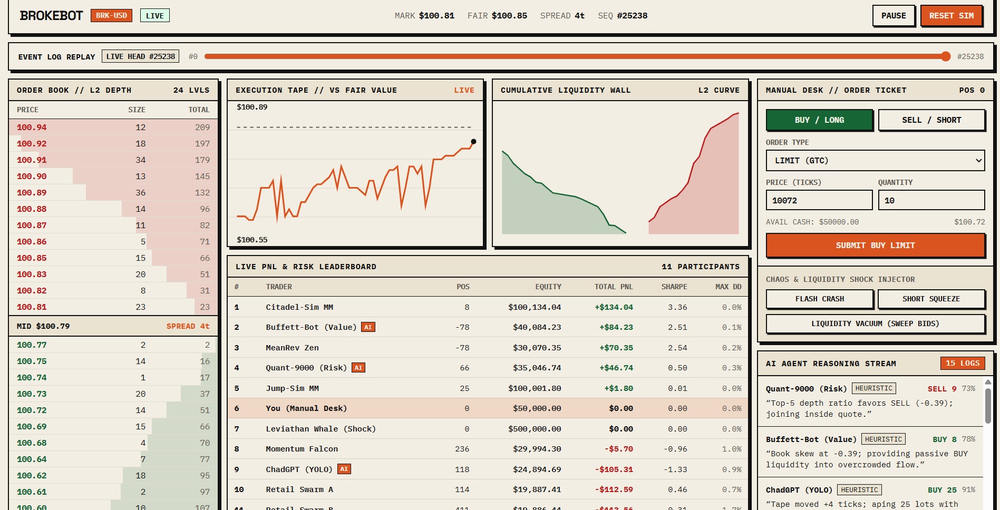

# brokebot

**Live Demo:** [https://brokebot-exchange.vercel.app](https://brokebot-exchange.vercel.app)

A deterministic Limit Order Book (LOB) matching engine, multi-agent market simulator, and real-time editorial trading terminal built with TypeScript, WebSockets, and React.

---

## Overview

`brokebot` models an electronic exchange from the matching core up to the trader workstation. Every state transition in the exchange is processed sequentially as an immutable command, producing a deterministic event log that drives double-entry account ledgers, risk metrics, live WebSocket broadcasts, and exact point-in-time state reconstruction.

### Key Engineering Highlights

* **Deterministic Matching Core:** Strict price-time priority (FIFO) matching across `LIMIT`, `MARKET`, `IOC`, `FOK`, and `POST_ONLY` order types using integer tick pricing (`1 tick = $0.01`) to eliminate floating-point drift.
* **Event-Sourced Time Travel:** Every fill, rest, cancel, and rejection emits a sequenced event (`#0` to `LIVE HEAD`), reconstructing a 5,000-command historical order book and ledger state in **17.31 ms** (**6.92%** of a 250ms live market tick budget).
* **Double-Entry Ledger & Risk Engine:** Tracks cash balances, net inventory, realized/unrealized PnL, rolling Sharpe ratio, and peak-to-trough maximum drawdown across all market participants in real time.
* **Multi-Agent Market Ecosystem:** Simulates competing liquidity providers, mean-reversion and momentum strategies, retail order flow, and persona-driven AI agents (`Buffett-Bot`, `ChadGPT`, `Quant-9000`) with structured JSON decision schemas and deterministic heuristic fallbacks.
* **Chaos & Liquidity Shock Injector:** Real-time WebSocket gateway featuring on-demand `FLASH_CRASH`, `SHORT_SQUEEZE`, and `LIQUIDITY_VACUUM` stress tests.
* **Zero-Chart-Library Editorial Terminal:** React + HTML5 Canvas workstation (`74.43 kB` gzipped, **69.3%** payload reduction from `242.15 kB` raw) with an L2 depth ladder (click-to-fill pricing), execution tape vs. fair-value plotting, cumulative depth curves, live leaderboard, AI reasoning feed, and an event-log replay scrubber.

---

## Performance & Verification Metrics

Measured across **100,000** mixed `LIMIT`, `MARKET`, and `CANCEL` commands (`npm run bench`), historical event replay, V8 test coverage, and production Vite bundle builds:

| Benchmark / Metric | Result |
| :--- | :--- |
| **Matching Engine Throughput** | **299,777 orders/sec** (58,161 matched trades across 100k commands) |
| **Matching Latency (p50 / p95 / p99)** | **2.50 µs** / **5.30 µs** / **12.10 µs** |
| **5,000-Command Replay Reconstruction** | **17.31 ms** (**6.92%** of a 250ms live market tick) |
| **Core Engine Coverage** | **83.1% line** / **95.45% function** (**96.61%** sequencer, **94.8%** ledger) |
| **Production Web Bundle** | **74.43 kB gzipped** (**69.3% reduction** from `242.15 kB` raw) |

---

